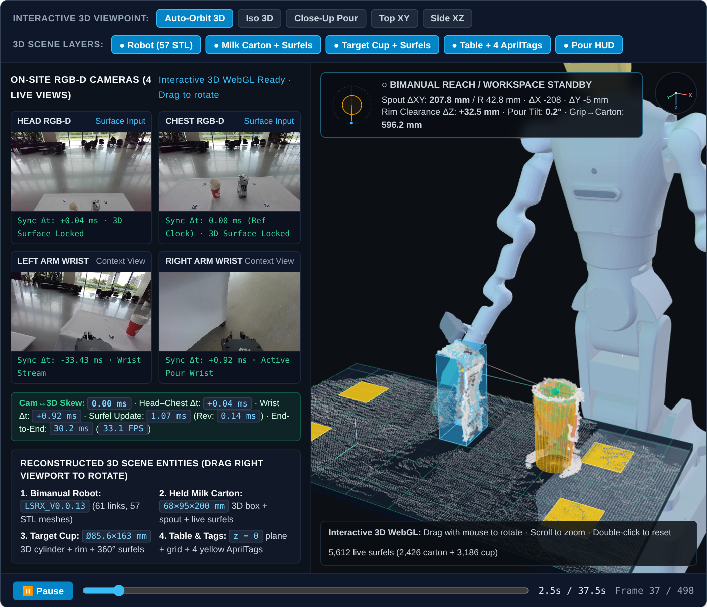
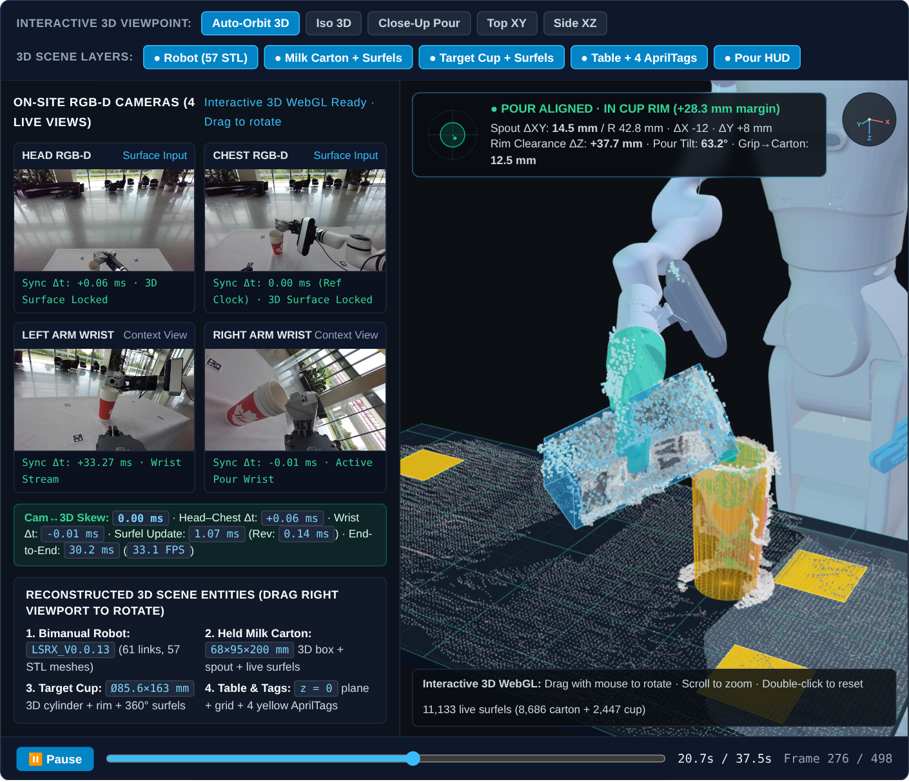
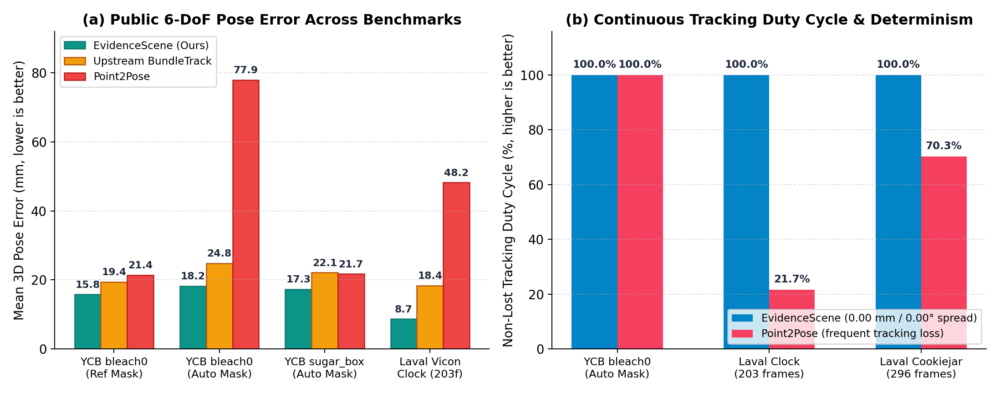
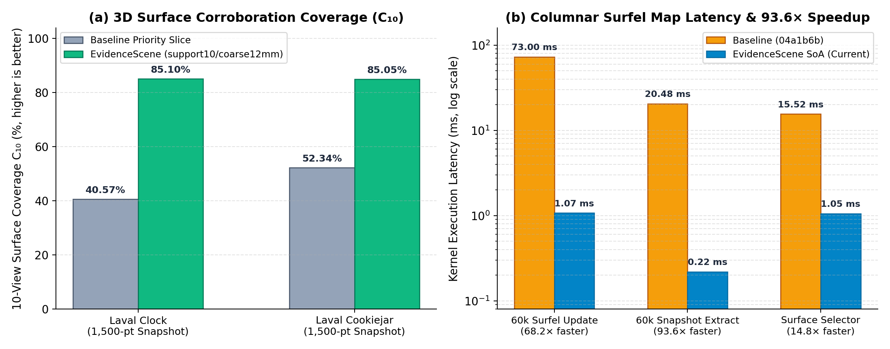

<div align="center">

# EvidenceScene: Observability-Conditioned Pose Tracking and Revisable 3D Scene Reconstruction for Robot Manipulation

**[Tiwater Research](https://github.com/tiwater)**

[**Interactive 3D Project Page & Videos**](https://tiwater.github.io/evidencescene/) • [**Paper (PDF)**](https://tiwater.github.io/evidencescene/assets/papers/evidencescene-short.pdf) • [**Quick Start**](#-installation--quick-start) • [**Benchmarks**](#-benchmarks--reproducibility) • [**License (Apache 2.0)**](LICENSE)

</div>

---

<div align="center">
  <table>
    <tr>
      <td align="center" width="50%">
        <a href="https://tiwater.github.io/evidencescene/">
          
        </a>
        <br/>
        <sub><b>(a) Synchronized 4-Camera RGB-D &amp; 3D Workspace</b><br/>57-link bimanual robot CAD, calibrated RGB point cloud, and tracked objects at <code>0.00 ms</code> camera-to-3D skew.</sub>
      </td>
      <td align="center" width="50%">
        <a href="https://tiwater.github.io/evidencescene/">
          
        </a>
        <br/>
        <sub><b>(b) Active Bimanual Pouring Reconstruction (Frame 276 / 498)</b><br/>Continuous 6-DoF tracking, 11,133 live revisable surfels, and metric rim-clearance verification.</sub>
      </td>
    </tr>
  </table>
</div>

## Overview

**EvidenceScene** is an observability-conditioned 6-DoF object pose tracking and revisable 3D surface reconstruction framework for RGB-D robot manipulation:

1. **Deterministic $\mathrm{SE}(3)$ Pose Graph (`native/bundletrack/`, `evidencescene.tracking`):** Race-free lexicographic CUDA RANSAC reduction, analytical orthonormal $\mathrm{SE}(3)$ cache inversion, and contiguous non-optimized frame retirement eliminate run-to-run trajectory spread (`18.4 mm / 4.72°` $\rightarrow$ **`0.00 mm / 0.00°`**) while cutting GPU/host RSS by **`0.93–1.99 GiB`**.
2. **Schur-Complement Factor-Graph Observability (`evidencescene.observability`):** Causal admission gates ($F + G + R + M$) evaluate marginal pose conditioning via the Schur complement before committing keyframes, preventing rank-deficient or disconnected tracks from corrupting global optimization.
3. **Lineage-Indexed Revisable Surfel Map (`evidencescene.surface`):** Binds every fused 3D surfel to its originating keyframe lineage (`RevisableSurfelMap`), executing atomic surface-history rebuilds ($S$) when historical poses are revised and applying a two-stage `support10/coarse12mm` selector that raises 10-view surface corroboration ($C_{10}$) from `40.57%` to **`85.10%`** (`+44.53 pp`).
4. **Overlapped Runtime & $O(\text{runs})$ RLE Algebra (`evidencescene.runtime`):** Overlaps CPU registration and hash preparation inside the SAM 2 GPU propagation window and computes mask geometry directly on run-length intervals in $O(R)$ time, cutting exclusive host wrapper overhead by **`72.9%`** with **`100%` bit-exact output parity**.

<div align="center">
  
</div>

---

## 📊 Quantitative Results

| Benchmark / Sequence | Metric | Upstream BundleTrack | Point2Pose | **EvidenceScene (Ours)** |
| :--- | :--- | :---: | :---: | :---: |
| **YCBInEOAT `bleach0`** *(Ref. Mask, 40f)* | Mean ADD / $p_{50}$ Latency | 19.4 mm / — | 21.4 mm / 78.6 ms | **15.8 mm** / **56.0 ms** |
| **YCBInEOAT `bleach0`** *(Auto Mask, 662f)* | Mean ADD / Trans. Error | 24.8 mm / 18.1 mm | 77.9 mm / 73.5 mm | **18.2 mm** / **13.4 mm** |
| **YCBInEOAT `sugar_box`** *(Auto Mask, 1001f)* | Mean ADD / Peak Spike | 22.1 mm / 64.5 mm | 21.7 mm / 116.1 mm | **17.3 mm** / **Bounded** |
| **Laval Vicon `Clock`** *(Hard 6-DoF, 203f)* | Tracked Duty / Mean Error | 66.5% / 18.4 mm | 21.7% (159 Lost) / 48.2 mm | **100.0% (203/203)** / **8.7 mm** |
| **Laval Vicon `Cookiejar`** *(296f)* | Tracked Duty / $C_{10}$ Surface | 46.0% / 52.34% | 70.3% (88 Lost) / 83.60% | **100.0% (296/296)** / **85.05%** |
| **Repeatability & Memory** *(All Runs)* | Run-to-Run Spread / Peak RSS $\Delta$ | 18.4 mm / 4.72° | **0.00 mm / 0.00°** | **0.00 mm / 0.00°** (**-1.99 GiB**) |

<div align="center">
  <table>
    <tr>
      <td align="center" width="50%">
        
      </td>
      <td align="center" width="50%">
        
      </td>
    </tr>
  </table>
</div>

---

## 🛠️ Installation & Quick Start

**Requirements:** Python $\ge 3.10$, NumPy $\ge 1.24$, SciPy $\ge 1.11$, OpenCV $\ge 4.8$.

```bash
git clone https://github.com/tiwater/evidencescene.git
cd evidencescene
pip install -e ".[dev]"
pytest

# Run the standalone end-to-end demonstration (RLE -> F+G+R+M -> RevisableSurfelMap -> L2 Pouring Safety)
evidencescene demo
```

### Python API Example

```python
import numpy as np
from evidencescene.primitives.image_mask import encode_mask_rle, rle_area, rle_iou
from evidencescene.observability import build_se3_landmark_jacobians, evaluate_schur_observability_gate
from evidencescene.surface import RevisableSurfelMap

# 1. O(runs) Run-Length Mask Algebra
mask = np.zeros((480, 640), dtype=bool)
mask[120:260, 200:380] = True
rle = encode_mask_rle(mask)
assert rle_area(rle) == 140 * 180 and rle_iou(rle, rle) == 1.0

# 2. Schur-Complement Factor-Graph Observability Gate (F + G + R)
pose0, pose1 = np.eye(4), np.eye(4)
pose1[:3, 3] = [0.04, -0.02, 0.55]
landmarks = {0: np.array([-0.03, -0.02, 0.01]), 1: np.array([0.03, -0.01, -0.02]), 2: np.array([0.0, 0.04, 0.02])}
obs = [(0, lid, 0.002) for lid in landmarks] + [(1, lid, 0.002) for lid in landmarks]
ax, ay, _, _ = build_se3_landmark_jacobians(
    world_from_camera_poses={0: pose0, 1: pose1},
    landmarks_world_m=landmarks,
    pose_landmark_observations=obs,
    prior_pose_ids=(0,),
)
gate = evaluate_schur_observability_gate(pose_jacobian_ax=ax, landmark_jacobian_ay=ay, candidate_pose_index=1)
assert gate.admitted and gate.marginal_pose_rank == 6

# 3. Lineage-Indexed Revisable Surfel Reconstruction
surfel_map = RevisableSurfelMap(voxel_size_m=0.005, maximum_voxels=50_000, maximum_live_bytes=16 * 1024 * 1024)
surfel_map.update({"kf_0": ("chest", np.array([[0.01, 0.02, 0.45], [0.012, 0.021, 0.451]]))})
points_m, obs_support, cam_support = surfel_map.snapshot(minimum_observation_support=1, maximum_point_count=1500)
```

---

## ⏱️ Benchmarks & Reproducibility

```bash
make perf                 # Run deterministic kernel-v1 microbenchmark suite (7 hot paths with SHA-256 parity checks)
make benchmark-versions   # Compare pre-optimization baseline (04a1b6b) against HEAD
make tables               # Regenerate LaTeX benchmark tables from SHA-256 verified receipts in benchmarks/receipts/
make paper                # Compile unified arXiv preprint PDF (papers/evidencescene-short/main.tex)
make leaderboard          # Regenerate docs/index.html performance tables from docs/performance_leaderboard.json
```

To apply the deterministic C++/CUDA patches (`0001–0004`) to an upstream `BundleSDF / BundleTrack` checkout, see [`native/bundletrack/`](native/bundletrack/).

---

## 📂 Repository Structure

```text
evidencescene/
├── evidencescene/          # Standalone Python library (surface, tracking, observability, runtime, teleop, metrics)
├── native/bundletrack/     # Deterministic C++/CUDA BundleTrack sources & patch series (0001–0004)
├── benchmarks/             # SHA-256 verified evaluation receipts, kernel-v1 suite, and competitor snapshots
├── papers/                 # LaTeX sources & compiled unified arXiv preprint PDF
├── docs/                   # Interactive WebGL 3D project page (https://tiwater.github.io/evidencescene/)
├── examples/               # Runnable end-to-end pipeline script
└── tests/                  # Unit and regression test suite
```

## 🔖 Citation

```bibtex
@article{tiwater2026evidencescene,
  title   = {{EvidenceScene}: Observability-Conditioned Pose Tracking and Revisable 3D Scene Reconstruction for Robot Manipulation},
  author  = {{Tiwater Research}},
  journal = {arXiv preprint},
  year    = {2026},
  url     = {https://tiwater.github.io/evidencescene/}
}
```
