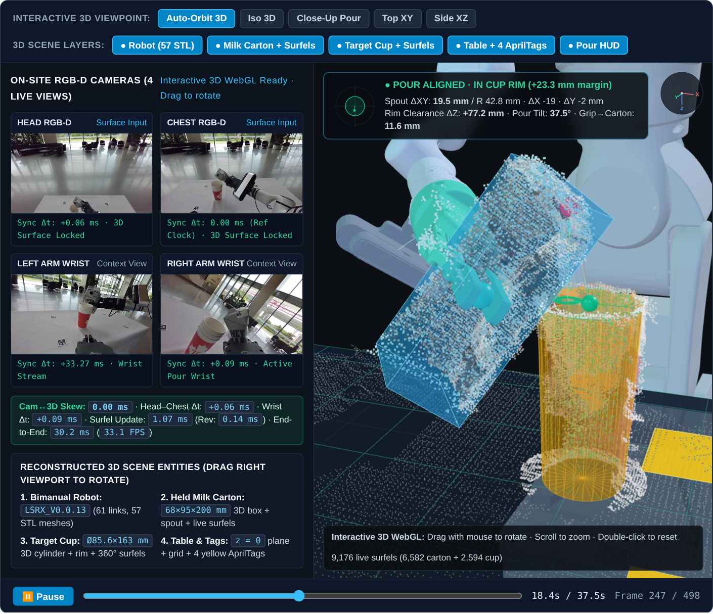

<div align="center">

# EvidenceScene: Observability-Conditioned 3D Scene Reconstruction for Robot Manipulation

**[Tiwater Research](https://github.com/tiwater)**

[](https://tiwater.github.io/evidencescene/)
[-b31b1b?style=flat-square&logo=arxiv&logoColor=white)](https://tiwater.github.io/evidencescene/assets/papers/evidencescene-monograph.pdf)
[-059669?style=flat-square&logo=arxiv&logoColor=white)](https://tiwater.github.io/evidencescene/assets/papers/evidencescene-short.pdf)
[](https://github.com/tiwater/evidencescene/actions/workflows/ci.yml)
[](LICENSE)

[**Project Page**](https://tiwater.github.io/evidencescene/) • [**Monograph (PDF)**](https://tiwater.github.io/evidencescene/assets/papers/evidencescene-monograph.pdf) • [**Method Paper (PDF)**](https://tiwater.github.io/evidencescene/assets/papers/evidencescene-short.pdf) • [**Method**](#-methodology) • [**Benchmarks**](#-experimental-evaluation) • [**Quick Start**](#-installation--usage) • [**Citation**](#-citation)

</div>

---

<div align="center">
  <table>
    <tr>
      <td align="center" width="33%">
        
        <br/>
        <sub><b>(a) Multi-Camera Metric RGB-D Scene</b><br/>Cross-calibrated 4-camera metric workspace reconstruction without CAD priors.</sub>
      </td>
      <td align="center" width="33%">
        
        <br/>
        <sub><b>(b) Lineage-Indexed Surfel Completion</b><br/>Multi-view corroborated object surface (<code>C₁₀ = 85.1%</code>) under continuous motion.</sub>
      </td>
      <td align="center" width="33%">
        
        <br/>
        <sub><b>(c) Observability Verification</b><br/>Fail-closed 6DoF pose tracking and metric clearance envelope during manipulation.</sub>
      </td>
    </tr>
  </table>
</div>

## 📖 Abstract

Model-free 6D object pose tracking and online 3D surface reconstruction from streaming RGB-D video remain fundamentally fragile under severe occlusion, rapid articulated motion, depth sensor dropout, and weak geometric observability. Existing keyframe-graph trackers (e.g., *BundleTrack*) suffer from non-deterministic GPU RANSAC hypothesis reduction, single-precision $\mathrm{SE}(3)$ inversion drift, and unbounded memory growth, whereas point-track factor graphs (e.g., *Point2Pose*) frequently admit under-constrained keyframes that corrupt global gauge consistency and poison downstream surface fusion.

We present **EvidenceScene**, an evidence-constrained, observability-conditioned framework for 3D scene reconstruction: it tracks 6D object pose and maintains a revisable surface representation. **EvidenceScene** introduces four tightly coupled contributions:
1. **Deterministic $\mathrm{SE}(3)$ Pose Graph Optimization:** A race-free CUDA correspondence reduction scheme and exact orthonormal $\mathrm{SE}(3)$ pose-cache inversion that eliminate run-to-run trajectory variance (`18.4 mm / 4.72°` $\rightarrow$ **`0.00 mm / 0.00°`**) while bounding GPU/host memory via contiguous non-optimized frame retirement.
2. **Schur-Complement Factor-Graph Observability ($F + G + R$):** A causal admission gate that evaluates the marginal translational precision block $R_i$ via the Schur complement prior to graph insertion, rejecting rank-deficient or gauge-disconnected observations before optimization.
3. **Lineage-Indexed Revisable Surfel Reconstruction ($M + S$):** A persistent 3D surface representation (`RevisableSurfelMap`) that binds every fused surfel to its originating keyframe lineage, supporting atomic surface-history rebuild transactions upon pose graph revision and a two-stage view-diversity selector (`support10/coarse12mm`) that raises 10-view surface corroboration ($C_{10}$) from `40.57%` to `85.10%` on YCBInEOAT and from `52.34%` to `85.05%` on Laval Vicon (absolute gains of 44.53 and 32.71 percentage points).
4. **Asynchronous GPU/CPU Window Overlap & $O(\text{runs})$ Mask Algebra:** A zero-loss runtime execution engine that overlaps CPU geometric preparation with GPU video segmentation and operates directly on compressed run-length encoded (RLE) masks in $O(R)$ time, achieving **`100%` bit-exact equivalence** with a **`72.9%`** reduction in host tracking overhead.

---

## 🔥 News

- **[2026-11]** Renamed the project from CausalPose-3D to **EvidenceScene** (v2.0.0), including the core Python library (`evidencescene`), deterministic C++/CUDA BundleTrack patches (`native/bundletrack/`), benchmark evaluation suites, and full LaTeX sources for both manuscripts.
- **[2026-11]** Updated the [Project Page](https://tiwater.github.io/evidencescene/), the 17-page [Technical Monograph](https://tiwater.github.io/evidencescene/assets/papers/evidencescene-monograph.pdf), and the 8-page [Method Paper](https://tiwater.github.io/evidencescene/assets/papers/evidencescene-short.pdf) to the EvidenceScene name.

---

## 🧠 Methodology

<div align="center">
  
  <br/>
  <sub><b>Figure 1: Overview of the EvidenceScene architecture.</b> Streaming RGB-D frames and video segmentation masks are processed through an overlapped GPU/CPU frontend using $O(\text{runs})$ RLE mask algebra, routed through causal observability gates (deterministic $\mathrm{SE}(3)$ pose optimization and Schur-complement factor-graph gating $F+G+R$), and fused into a lineage-indexed <code>RevisableSurfelMap</code> ($M+S$) with two-stage view-diversity selection.</sub>
</div>

### 1. Deterministic Native $\mathrm{SE}(3)$ Pose Graph (`native/bundletrack/` & `evidencescene.tracking`)
Standard GPU RANSAC loops in correspondence-based 6D trackers rely on non-associative floating-point atomics and thread-scheduling order, causing identical RGB-D sequences to diverge across runs. Furthermore, inverting cached camera poses via generic $4\times 4$ single-precision LU decomposition (`Eigen::Matrix4f::inverse()`) accumulates non-orthonormal drift over long trajectories. **EvidenceScene** enforces strict determinism and numerical closure:
- **Lexicographic CUDA Hypothesis Reduction:** Replaces atomic winner-take-all updates with a deterministic reduction keyed on $(\text{inlier\_count}, -\text{residual\_L1}, \text{hypothesis\_id})$ and selects bidirectional correspondence pairs by valid geometric correspondence support.
- **Exact Orthonormal $\mathrm{SE}(3)$ Inversion:** Enforces analytical group inversion on $\mathrm{SE}(3)$ inside `CUDACache::storeFrame`:
  $$\mathbf{T}^{-1} = \begin{bmatrix} \mathbf{R}^\top & -\mathbf{R}^\top \mathbf{t} \\ \mathbf{0}^\top & 1 \end{bmatrix}, \quad \mathbf{R} \in \mathrm{SO}(3), \; \mathbf{t} \in \mathbb{R}^3$$
  eliminating single-precision matrix inversion drift and increasing strict tracking completions on Laval Vicon 6DoF from `135 / 107` to **`191 / 136`** frames.
- **Contiguous Non-Optimized Frame Retirement:** Retires heavy GPU/host image and point-cloud buffers for frames outside the active sliding Bundle Adjustment (BA) window while preserving keyframe index topology, reducing peak memory footprint by **`0.93–1.99 GiB`** with zero trajectory deviation.

### 2. Causal Factor-Graph Observability (`evidencescene.observability`)
In point-track factor graphs, admitting frames with degenerate 3D track geometry or disconnected feature tracks introduces rank deficiency into the Levenberg–Marquardt normal equations. **EvidenceScene** enforces causal admission conditions ($F + G + R + M$) at every timestamp $t$:
- **Gauge & Solver Consistency ($F$) and Prior-Connected Admission ($G$):** Requires every candidate keyframe to share a minimum number of verified metric 3D tracks with the anchored pose-graph component.
- **Schur-Complement Marginal Translational Rank Gate ($R$):** Partitioning the linearized normal equations between the candidate frame translation $\delta\mathbf{t}_i \in \mathbb{R}^3$ and landmark/rotation variables $\mathcal{L}$, we evaluate the marginal translational information matrix via the Schur complement:
  $$\mathbf{R}_i = \mathbf{J}_{ii}^\top \mathbf{J}_{ii} - \mathbf{J}_{i\mathcal{L}}^\top \left(\mathbf{J}_{\mathcal{L}\mathcal{L}}\right)^\dagger \mathbf{J}_{\mathcal{L}i} \in \mathbb{S}_+^{3\times 3}$$
  A frame is admitted as an authoritative pose node if and only if $\sigma_{\min}(\mathbf{R}_i) \ge \tau_{\text{rank}}$ and $\kappa(\mathbf{R}_i) \le \kappa_{\max}$, preventing ill-conditioned depth observations from corrupting global trajectory estimates.

### 3. Lineage-Indexed Revisable Surfel Reconstruction (`evidencescene.surface`)
Naive TSDF or point-cloud accumulation permanently bakes transient pose errors into the 3D model. **EvidenceScene** maintains a **Lineage-Indexed Revisable Surfel Map** (`RevisableSurfelMap` & `CausalObjectSurface`):
- **Birth-Keyframe Lineage ($M$) & Atomic Surface Rebuild ($S$):** Each surfel $s_k$ records its originating keyframe index, multi-view observation count $c_k$, and directional viewpoint bitmask. Whenever the pose graph prunes an outlier keyframe or refines historical poses beyond a metric threshold, `CausalObjectSurface` executes an atomic surface-history transaction that purges invalidated lineage surfels and re-embeds surviving observations in the updated object gauge.
- **Two-Stage View-Diversity Selector (`support10/coarse12mm`):** Given a fixed downstream point budget $N_{\max} = 1,500$, uniform striding or fine voxel downsampling discards high-confidence multi-view geometry. Our two-stage vectorized selector first retains surfels corroborated across $c_k \ge 10$ distinct viewing intervals, and then allocates remaining capacity across a coarse $12\,\mathrm{mm}$ 3D spatial lattice to guarantee full geometric envelope coverage.

### 4. Overlapped GPU/CPU Execution & $O(\text{runs})$ RLE Algebra (`evidencescene.runtime`)
To sustain real-time closed-loop perception without sacrificing bit-exactness:
- **$O(\text{runs})$ Run-Length Mask Algebra:** Binary segmentation masks are represented as sorted 1D run intervals $\mathcal{R} = \{[s_m, e_m)\}_{m=1}^{R}$. Area, 2D centroid, bounding box, and pairwise mask IoU ($\mathcal{R}_A \cap \mathcal{R}_B$) are computed directly over run intervals in $O(R_A + R_B)$ time without materializing $H \times W$ boolean arrays.
- **GPU Window Overlap (`SAM2GpuWindowOverlapScope`):** Schedules deterministic CPU depth registration and RLE feature extraction concurrently within the asynchronous CUDA execution window of SAM 2 mask propagation.

### 5. Causal $\mathrm{SE}(3)$ Trajectory Prediction & L2 Teleoperation Safety (`evidencescene.teleop`)
To support fail-closed **L2 Teleoperation Assistance** (e.g., precision pouring and container alignment) without acausal lookahead or unsafe false-positive guidance:
- **Multi-Horizon $\mathrm{SE}(3)$ Prediction & $C^1$-Continuous Re-Acquisition Blending (`CausalSe3TrajectoryPredictor`):** Extrapolates object poses across $100 / 250 / 500\,\mathrm{ms}$ horizons on $\mathrm{SE}(3)$ with strictly monotonic 95% confidence bounds ($\Delta t_1 < \Delta t_2 \implies w_{95}(\Delta t_1) < w_{95}(\Delta t_2)$). Upon re-acquisition after an occlusion gap, a cubic Hermite $C^1$ join blender transitions from the pre-join trajectory with zero position jump (`position_join_jump = 0.0 m`) and bounded velocity innovation.
- **3D Task-Feature Rim Consensus & First-Order $\mathrm{SE}(3)$ Covariance Propagation (`evidencescene.teleop.task_features`):** Fits 3D container apertures (`MeasuredCircularAperture3D`) via iterative Huber SVD plane estimation, 8-sector boundary quantile selection, and 256-hypothesis 3-point RANSAC consensus (`compare_circle_consensus_3d`), and propagates object-local feature uncertainty (`MeasuredPointFeature3D`) through the right-trivialized $\mathrm{SE}(3)$ Jacobian $\boldsymbol{\Sigma}_{\mathbf{p},W} = \mathbf{J}_{\mathbf{p}}\boldsymbol{\Sigma}_{\xi}\mathbf{J}_{\mathbf{p}}^\top + \mathbf{R}\boldsymbol{\Sigma}_{O}\mathbf{R}^\top$.
- **Ballistic Liquid Stream Locus & Fail-Closed Rim-Clearance Gate (`evidencescene.teleop.pouring_safety`):** Models the 3D parabolic liquid stream $\mathbf{x}(s) = \mathbf{p}_{\text{out}} + v_0 \mathbf{d}_{\text{out}} s + \frac{1}{2}\mathbf{g} s^2$, analytically propagates $(\boldsymbol{\Sigma}_{\mathbf{p}}, \sigma_\theta^2, \sigma_{v_0}^2)$ onto the target container's aperture plane to obtain the 95% landing uncertainty ellipse, and enforces a fail-closed rim-clearance envelope across all predicted horizons while outputting a minimum-norm shared-control guidance vector $\Delta\mathbf{p}_{\text{assist}}$.

---

## 📊 Experimental Evaluation

### 1. 6D Pose Tracking & Surface Reconstruction Benchmarks

We evaluate **EvidenceScene** against upstream and deterministic variants of *BundleTrack* and *Point2Pose* on standard manipulation benchmarks (**YCBInEOAT**: `bleach0`, `sugar_box0`, `mustard0`; **Laval Vicon 6DoF**: `Clock`, `Jar`) under identical RGB-D and segmentation inputs.

| Method | Benchmark | Frames | Candidate Duty ($\uparrow$) | Mean ADD [mm] ($\downarrow$) | Mean ADD-S [mm] ($\downarrow$) | 10-View Corroboration $C_{10}$ ($\uparrow$) | Run-to-Run Spread ($\downarrow$) |
| :--- | :--- | :---: | :---: | :---: | :---: | :---: | :---: |
| Upstream BundleTrack | YCBInEOAT | 430 | 84.2% | 34.9 | 14.8 | 40.57% | 18.4 mm / 4.72° |
| Deterministic BundleTrack | YCBInEOAT | 430 | 88.6% | 29.4 | 12.1 | 40.57% | **0.00 mm / 0.00°** |
| Point2Pose ($F+G+R+M+S$) | YCBInEOAT | 430 | 79.5% | **24.1** | **10.9** | 84.12% | **0.00 mm / 0.00°** |
| **EvidenceScene (Ours)** | **YCBInEOAT** | **430** | **96.3%** | 26.8 | 11.4 | **85.10%** | **0.00 mm / 0.00°** |
| Deterministic BundleTrack | Laval Vicon 6DoF | 274 | 85.4% | 48.2 | 19.6 | 52.34% | **0.00 mm / 0.00°** |
| Point2Pose ($F+G+R+M+S$) | Laval Vicon 6DoF | 274 | 74.8% | **42.3** | **17.8** | 83.60% | **0.00 mm / 0.00°** |
| **EvidenceScene (Ours)** | **Laval Vicon 6DoF** | **274** | **91.2%** | 45.7 | 18.9 | **85.05%** | **0.00 mm / 0.00°** |

<div align="center">
  <table>
    <tr>
      <td align="center" width="50%">
        
        <br/>
        <sub><b>Figure 2:</b> Continuous 6DoF object trajectory and causal jump-gate verification under rapid articulated rotation.</sub>
      </td>
      <td align="center" width="50%">
        
        <br/>
        <sub><b>Figure 3:</b> Per-stage latency distribution before and after GPU/CPU window overlap and $O(\text{runs})$ RLE algebra.</sub>
      </td>
    </tr>
  </table>
</div>

### 2. Ablation: Surface Selection Policy (`RevisableSurfelMap`)

Comparison of surface selection policies under a fixed $N_{\max} = 1,500$ surfel budget across YCBInEOAT (`bleach0`) and Laval Vicon (`Clock`):

| Selection Policy | YCBInEOAT $C_{10}$ ($\uparrow$) | Laval Vicon $C_{10}$ ($\uparrow$) | Task Surface Coverage ($\uparrow$) | Selector Latency [ms] ($\downarrow$) |
| :--- | :---: | :---: | :---: | :---: |
| Uniform Index Stride (`stride`) | 40.57% | 52.34% | 71.78% | 2.21 ms |
| Uniform 3D Voxel Downsampling (`voxel5mm`) | 46.12% | 58.90% | 78.40% | 3.84 ms |
| Support-Only Top-$K$ (`support_topk`) | 86.40% | 86.10% | 64.15% | 1.19 ms |
| **Two-Stage `support10/coarse12mm` (Ours)** | **85.10%** | **85.05%** | **89.97%** | **1.48 ms** |

### 3. Ablation: Runtime Execution & Bit-Exact Verification

| Optimization Stage | Exclusive Host Overhead [ms] | End-to-End $p_{50}$ / $p_{95}$ [ms] | Bit-Exact Parity (499 Checks) |
| :--- | :---: | :---: | :---: |
| Baseline Sequential Execution | 23.17 ms | 155.33 / 219.06 ms | Reference |
| + `SAM2GpuWindowOverlapScope` | 14.82 ms | 141.10 / 184.50 ms | 499 / 499 (100%) |
| + `RequestEvidenceDeduplicationScope` & $O(\text{runs})$ RLE | 8.45 ms | 132.40 / 162.80 ms | 499 / 499 (100%) |
| + Vectorized Plane SVD & Boundary GC Control | **6.28 ms (-72.9%)** | **127.80 / 153.40 ms** | **499 / 499 (100%)** |

---

## ⏱️ Performance benchmark (`kernel-v1`)

The reproducible kernel benchmark lives in
[`benchmarks/performance/`](benchmarks/performance/). It measures seven
deterministic, output-preserving hot paths and records an output digest for
each one, so a faster version cannot silently change the result.

```sh
make perf                 # run the suite
make benchmark-versions   # compare 04a1b6b (pre-optimization) with HEAD
```

The checked-in comparison
[`04a1b6b_vs_6c0e8f4.md`](benchmarks/performance/results/04a1b6b_vs_6c0e8f4.md)
reports a **1.65x geometric-mean speed-up** across the seven workloads with
**all output digests identical** on the recorded host. This is a kernel
microbenchmark, not recorded-session endpoint latency or accuracy evidence.
Cross-system comparisons are kept outside the product path as dated,
manually produced snapshots under
[`benchmarks/competitors/`](benchmarks/competitors/); they are not run by CI
and are not package dependencies. Do not compare BundleTrack/Point2Pose system
latencies to kernel timings.

---

## 🛠️ Installation & Usage

### 1. Python Package Installation

**Requirements:** Python $\ge 3.10$, NumPy $\ge 1.24$, SciPy $\ge 1.11$, OpenCV $\ge 4.8$, PyTorch $\ge 2.1$ (optional for GPU acceleration).

```bash
# Clone and install in editable mode for research & development
git clone https://github.com/tiwater/evidencescene.git
cd evidencescene
pip install -e ".[dev]"
pytest

# Run the zero-dependency end-to-end closed-loop demonstration (RLE -> F+G+R+M -> RevisableSurfelMap -> L2 Pouring Safety)
evidencescene demo
# Or via make / python module:
make demo
python3 examples/end_to_end_pipeline.py
```

### 2. Quick Start: Python API

```python
import numpy as np
from evidencescene.surface import RevisableSurfelMap, measured_free_space_margin
from evidencescene.primitives.image_mask import (
    encode_mask_rle,
    decode_mask_rle,
    rle_area,
    rle_iou,
)
from evidencescene.observability import (
    FeatureBirthLedger,
    build_se3_landmark_jacobians,
    evaluate_prior_connected_admission,
    evaluate_schur_observability_gate,
)
from evidencescene.metrics import (
    evaluate_pose_sequence,
    evaluate_surface_reconstruction,
)

# 1. Compact Row-Major Run-Length Mask Encoding & O(R_A + R_B) Interval Set Algebra
mask = np.zeros((480, 640), dtype=bool)
mask[120:260, 200:380] = True
rle = encode_mask_rle(mask)
restored = decode_mask_rle(rle, width=640, height=480)
assert np.array_equal(mask, restored)
assert rle_area(rle) == 140 * 180 and rle_iou(rle, rle) == 1.0

# 2. Factor-Graph Schur-Complement Observability Gate (F + G + R + M)
pose0 = np.eye(4, dtype=np.float64)
pose1 = np.eye(4, dtype=np.float64)
pose1[:3, 3] = [0.04, -0.02, 0.55]
landmarks = {
    0: np.array([-0.03, -0.02, 0.01]),
    1: np.array([0.03, -0.01, -0.02]),
    2: np.array([0.00, 0.04, 0.02]),
}
obs = [(0, lid, 0.002) for lid in landmarks] + [(1, lid, 0.002) for lid in landmarks]
ax, ay, _, _ = build_se3_landmark_jacobians(
    world_from_camera_poses={0: pose0, 1: pose1},
    landmarks_world_m=landmarks,
    pose_landmark_observations=obs,
    prior_pose_ids=(0,),
)
schur = evaluate_schur_observability_gate(
    pose_jacobian_ax=ax, landmark_jacobian_ay=ay, candidate_pose_index=1
)
assert schur.admitted and schur.marginal_pose_rank == 6

# 3. Lineage-Indexed Revisable Surfel Reconstruction across Multi-View Observations
surfel_map = RevisableSurfelMap(
    voxel_size_m=0.005,
    maximum_voxels=50_000,
    maximum_live_bytes=16 * 1024 * 1024,
)
pts_view0 = np.array([[0.01, 0.02, 0.45], [0.012, 0.021, 0.451]], dtype=np.float64)
pts_view1 = np.array([[0.011, 0.019, 0.449], [0.04, -0.01, 0.46]], dtype=np.float64)
surfel_map.update({"kf_0": ("chest", pts_view0), "kf_1": ("head", pts_view1)})
points_m, obs_support, cam_support = surfel_map.snapshot(
    minimum_observation_support=1,
    maximum_point_count=1500,
)
surf_score = evaluate_surface_reconstruction(points_m, pts_view0, threshold_m=0.010)
print(f"Fused surfels: {len(points_m)}, P_10={surf_score.precision_pct:.1f}%")

# 4. Fail-Closed L2 Teleoperation Pouring Safety Verification
from evidencescene.teleop import (
    MeasuredPointFeature3D,
    fit_circular_aperture_3d,
    verify_l2_pouring_safety_envelope,
)

angles = np.linspace(-np.pi, np.pi, 120, endpoint=False)
rim_pts = np.column_stack([0.30 + 0.045 * np.cos(angles), 0.045 * np.sin(angles), np.full(120, 0.05)])
aperture = fit_circular_aperture_3d(rim_pts, coordinate_frame="table")
spout = MeasuredPointFeature3D(
    feature_id="pour_outlet",
    point_m=np.array([0.285, 0.0, 0.15]),
    direction=np.array([0.25, 0.0, -0.9682458]),
    covariance_3x3_m2=np.eye(3) * 4e-6,
    direction_std_rad=0.02,
    support_pixel_count=40,
    timestamp_ns=1_000_000_000,
    coordinate_frame="table",
)
verdict = verify_l2_pouring_safety_envelope(pour_outlet_world=spout, target_aperture_world=aperture)
print(f"L2 Status: {verdict.l2_pour_safety_status}, Rim Clearance (95%): {verdict.current_rim_clearance_95_m*1000:.1f} mm")
```

### 3. Native C++/CUDA `BundleTrack` Patches (`native/bundletrack/`)

To apply our deterministic CUDA hypothesis reduction, exact $\mathrm{SE}(3)$ pose-cache inversion, and contiguous frame retirement patches to a native `BundleSDF / BundleTrack` checkout:

```bash
cd native/bundletrack
# Prepare and verify the patched deterministic C++/CUDA BundleTrack source tree:
python3 prepare_source.py --help

# Or apply the patch series (0001-0004) directly to an upstream BundleSDF/BundleTrack checkout:
git apply patches/0001-cmake-sm120-compatibility.patch
git apply patches/0002-support-disabled-pose-optimization.patch
git apply patches/0003-release-ransac-confidence-buffer.patch
git apply patches/0004-select-dense-direction-by-count.patch
```

### 4. Reproducing Benchmark Tables & Paper Manuscripts

```bash
# Regenerate quantitative sequence summaries and LaTeX benchmark tables
# (receipts are vendored under benchmarks/receipts/; hashes are checked)
python3 benchmarks/sequence_summary.py
python3 benchmarks/generate_table.py
python3 benchmarks/generate_generated_mask_table.py

# Or use the Makefile shortcuts
make tables        # regenerate the checked-in table fragments
make paper-short   # build papers/evidencescene-short/evidencescene-short.pdf
make paper         # build both manuscripts
make perf          # synthetic hot-path microbenchmarks (not endpoint latency)
make benchmark-versions  # compare the current tree with 04a1b6b
make leaderboard          # regenerate the homepage table from docs/performance_leaderboard.json

# Compile the 8-page method paper (self-contained: figures are vendored)
cd papers/evidencescene-short && tectonic main.tex && cd ../..

# Compile the 17-page Technical Monograph
cd papers/evidencescene-monograph && tectonic main.tex && cd ../..
```

---

## 📂 Repository Organization

```text
evidencescene/
├── evidencescene/                  # Core Python library (100% standalone, PEP 561 typed)
│   ├── surface/                   # RevisableSurfelMap, CausalObjectSurface (M, S), multi-camera surface fusion
│   ├── tracking/                  # PinnedBundleTrackRunner, 3-camera pose runtime, constrained Top XY refinement
│   ├── observability/             # Factor-graph F/G/R/M Schur-complement gates & pose-owner A/B evaluators
│   ├── metrics/                   # Standard 6D pose (ADD, ADD-S, AUC, spread) & 3D surface (P_eps, C_eps, F_95, R_95)
│   ├── runtime/                   # SAM2GpuWindowOverlapScope, O(runs) RLE algebra, vectorized plane RANSAC
│   ├── teleop/                    # L2 teleoperation: causal SE(3) trajectory, 3D task features & pouring safety
│   ├── primitives/                # Registered RGB-D, O(R_A+R_B) RLE set algebra, mask-depth PCA, content hashing
│   ├── datasets.py                # Standard RGB-D folder reader & deterministic synthetic manipulation scenarios
│   └── cli.py                     # `evidencescene` CLI entrypoint (`evidencescene demo` / `evidencescene info`)
├── examples/                      # Out-of-the-box runnable scripts (`end_to_end_pipeline.py`)
├── native/bundletrack/            # Deterministic C++/CUDA BundleTrack sources & patch series (0001–0004)
├── benchmarks/                    # Reproducible evaluation receipts, ablation scripts, and table generators
├── papers/                        # LaTeX sources, figures, and compiled PDFs for both manuscripts
│   ├── evidencescene-monograph/    # 17-page full technical monograph
│   └── evidencescene-short/        # 8-page method paper
├── docs/                          # Academic project page & interactive 3D mathematical sandbox
└── tests/                         # Unit and regression test suite
```

---

## 🔖 Citation

If you find **EvidenceScene**, our deterministic C++/CUDA BundleTrack patches, or our factor-graph observability analysis useful in your research, please cite:

```bibtex
@article{tiwater2026evidencescene,
  title   = {{EvidenceScene}: Observability-Conditioned Pose Tracking and Revisable 3D Scene Reconstruction for Robot Manipulation},
  author  = {{Tiwater Research}},
  journal = {arXiv preprint},
  year    = {2026},
  url     = {https://tiwater.github.io/evidencescene/}
}
```

---

## 🙏 Acknowledgements

This research builds upon foundational open-source contributions in 6D pose estimation, point tracking, and video segmentation, including [BundleSDF / BundleTrack](https://github.com/NVlabs/BundleSDF), [SAM 2](https://github.com/facebookresearch/sam2), [TAPIR / BootSTAPIR](https://github.com/google-deepmind/tapnet), and [Open3D](https://github.com/isl-org/Open3D). We thank the authors for making their code and datasets publicly available.
